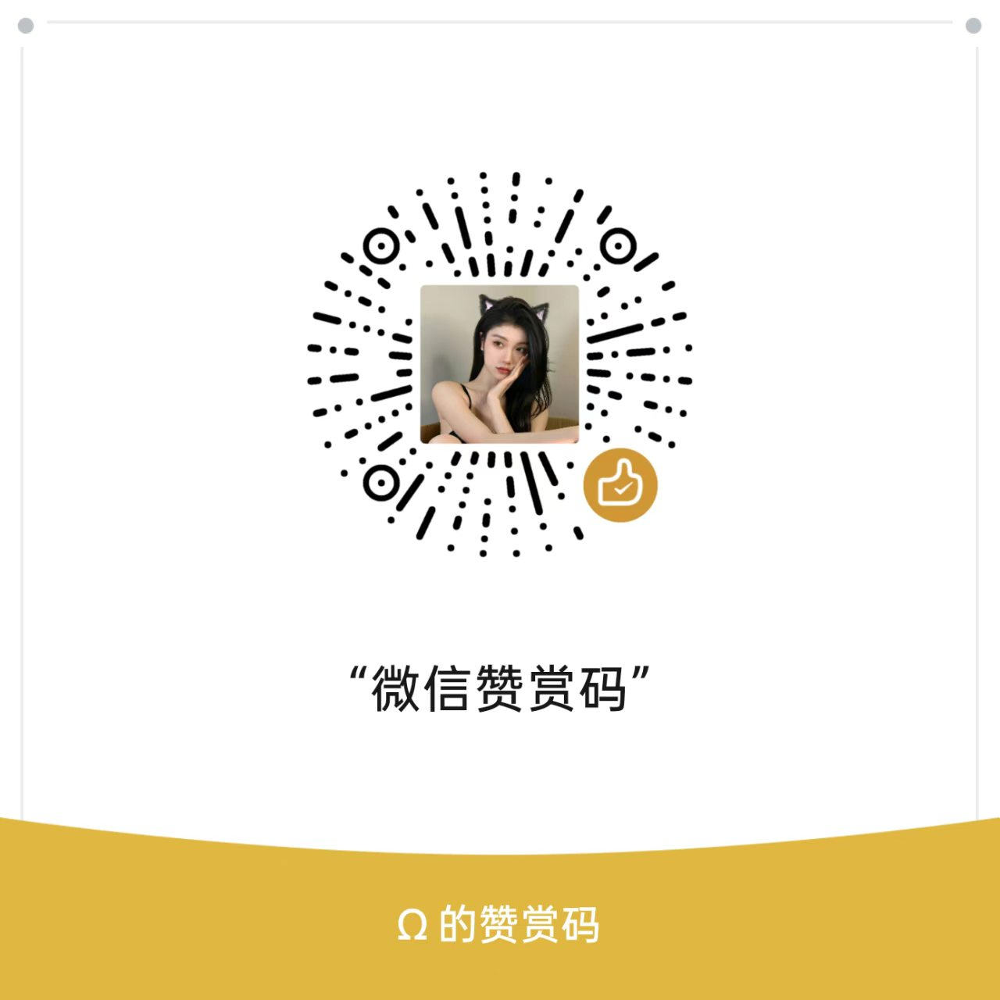
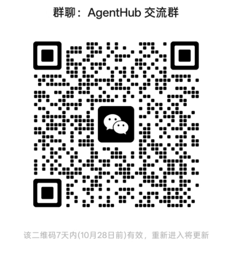

# ❤️ 支持本项目 / Support This Project

**AgentHub** 完全免费、开源，如果它帮你省下了 Token，欢迎扫码请作者喝瓶快乐水。

赞赏完全自愿，不影响项目的任何正常使用。

**同样的支持**：给仓库点一个 Star、反馈问题与建议、提交 PR、分享给需要的朋友。

**QQ 群**：AgentHub 交流群，群号 `110336924`（在 QQ 里搜索群号即可加入）；使用答疑与问题反馈都在这里。

**微信群**：习惯用微信的朋友也可以扫码加入「AgentHub 交流群」，群里同样有使用答疑、版本通知和踩坑经验分享。

群二维码 7 天内有效，若已过期，请在仓库提 Issue 索取最新入群方式

**赞助 / 商务合作**：想赞助或者让你的产品出现在本项目 README 里？或者如需定制开发 ERP、可视化大屏、微信小程序等各类项目，可加群联系作者。

---

## Support This Project

**AgentHub** is completely free and open source. If it has saved you some tokens, you are welcome to scan the code and buy the author a drink.

Donations are entirely voluntary and do not affect any normal use of the project.

**Other ways to help**: star the repository, report issues and suggestions, submit pull requests, or share it with people who might need it.

**QQ group**: AgentHub community group, ID `110336924` (search the number in QQ to join). Usage questions and issue reports are handled here.

**WeChat group**: If you prefer WeChat, scan the QR code below to join the AgentHub community group — same place for usage help, release notes, and troubleshooting tips.

The group QR code is valid for 7 days. If it has expired, please open an issue in the repository to get the latest invite.

**Sponsorship / business**: want to sponsor the project, or have your product featured in this README? Custom development (ERP systems, data dashboards, WeChat mini programs, etc.) is also available — join the group to get in touch with the author.
